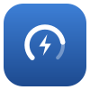

<p align="center"></p>

<h1 align="center">ChargeKeeper</h1>

<p align="center">Keeps your MacBook battery at the level you choose: charge limit, discharge while plugged in, calibration, heat protection, scheduling. A menu bar app for Apple silicon Macs.</p>

<p align="center"><a href="https://vlor999.github.io/chargekeeper/">Website</a> · <a href="https://github.com/Vlor999/chargekeeper/releases/latest">Download</a> · <code>brew install --cask vlor999/tap/chargekeeper</code></p>

## Features

- Charge limit from 20 to 100%
- Discharge while plugged in, manual or automatic
- Idle range: recharge only below a threshold
- Calibration cycle (100 → 10 → 100%, 1 h rest, back to the limit)
- Heat protection with 5-minute windows
- Charge to 100% once, until unplugged
- Power flow (adapter, battery, Mac) with a weak-adapter warning
- Schedule: limit, calibration, full charge, pause, discharge, Low Power Mode; missed tasks on wake; history
- MagSafe LED colors
- Keep awake until the limit, freeze the level during sleep
- Shortcuts actions and a CLI (`chargekeeperctl`)
- English and French UI (Settings > General > Language)

## Install

- Download the `.dmg` from the [website](https://vlor999.github.io/chargekeeper/) or the [releases](https://github.com/Vlor999/chargekeeper/releases), or `brew install --cask vlor999/tap/chargekeeper`.
- Signed and notarized by Apple. Drag ChargeKeeper to Applications and open it.
- On first launch, allow ChargeKeeper's background service in System Settings > General > Login Items. That root service is what talks to the battery controller.
- Updates install on their own (Sparkle, checked every 6 hours, EdDSA-signed).
- Formerly named Jauge. An existing install updates in place and keeps its file name `Jauge.app`; the CLI is now `chargekeeperctl`.

Command line: `chargekeeperctl status`, `chargekeeperctl limit 70`, `chargekeeperctl discharge on`… With Homebrew it is on your `PATH`; otherwise it lives in `/Applications/ChargeKeeper.app/Contents/MacOS/chargekeeperctl`.

## How it works

| Part | Role |
|---|---|
| `App/` | SwiftUI menu bar app, settings, Shortcuts actions, Sparkle updater |
| `Daemon/` | `chargekeeperctl daemon`: root service registered with `SMAppService`, owns all charging logic, talks to the SMC and to macOS's charge limit |
| `Shared/` | Model, charging policy (pure, tested by `make check`), socket client |

- macOS 26+: Apple's Manual Charge Limit (80–100%) through the private `PowerUI` framework; below 80%, the SMC discharge key `CHIE` alternates battery and adapter.
- Older firmware: SMC keys `CHTE` or `CH0B`/`CH0C` stop charging, `CHIE`/`CH0I` force discharge.
- The app and the CLI talk to the service over `/var/run/jauge.sock` (root:admin, 0660).

## Build

```sh
brew install xcodegen
make check   # charging policy self-test
make         # build/Build/Products/Release/ChargeKeeper.app (Developer ID identity required)
```

Releases: bump `VERSION`, push to `main`. See [docs/release.md](docs/release.md).

## Privacy

No account, no telemetry, no personal data collected. The only network request is the update check to GitHub (every 6 hours), which shows GitHub your IP address and macOS version. The [website](https://vlor999.github.io/chargekeeper/) is hosted on GitHub Pages, sets no cookie and serves its own fonts.

## Disclaimer

ChargeKeeper is provided as is, without warranty of any kind (see the license). Use it at your own risk. It uses undocumented macOS interfaces that may change with any update.

ChargeKeeper is an independent project. It is not affiliated with or endorsed by Apple, or by the makers of any other battery tool. Apple, Mac, MacBook, MagSafe and macOS are trademarks of Apple Inc., registered in the U.S. and other countries and regions.

## Third-party software

Sparkle and the website fonts: see [THIRD_PARTY_NOTICES.md](THIRD_PARTY_NOTICES.md).

## License

MIT
